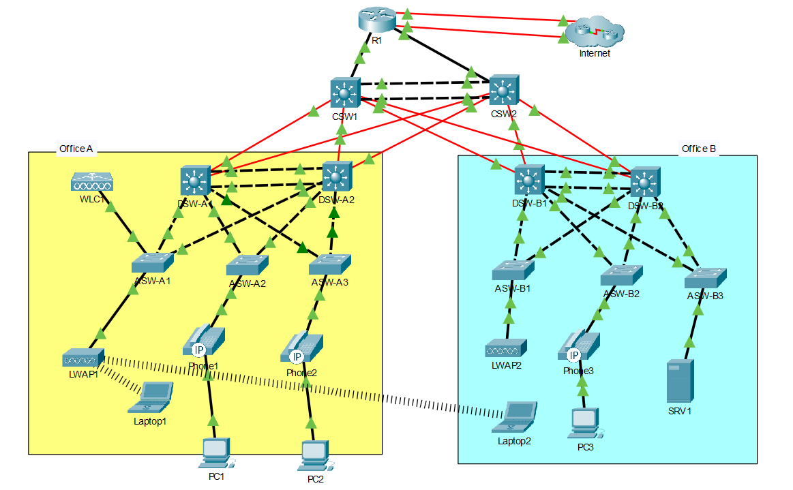

# Enterprise Network Engineering | Cisco Packet Tracer

## Project Overview

A hands-on enterprise networking project based on **Jeremy's IT Lab CCNA Mega Lab**, implemented using Cisco Packet Tracer.

The project simulates a multi-office enterprise network with a redundant core, distribution, and access layer architecture. It demonstrates practical skills in network configuration, routing, security, high availability, and troubleshooting.

## Network Topology

## Technologies Implemented

**Switching & Layer 2**
- VLANs, VTPv2, 802.1Q Trunking
- EtherChannel (PAgP & LACP)
- Rapid PVST+, PortFast, BPDU Guard

**Routing & High Availability**
- OSPF Area 0
- HSRPv2 with STP root alignment
- Inter-VLAN Routing
- Floating Static Routes & Internet Failover
- IPv4 & IPv6 Routing

**Network Services**
- DHCP & DHCP Relay, DNS
- NTP, SNMP, Syslog
- SSHv2, FTP
- Static NAT & Dynamic PAT

**Network Security**
- Standard & Extended ACLs
- Port Security & Sticky MAC
- DHCP Snooping & Dynamic ARP Inspection
- Secure Device Management

**Wireless Networking**
- Centralized Wireless LAN Controller (WLC)
- Lightweight Access Points (LWAPs)
- WPA2-AES Wireless Security
- Wireless VLAN Segmentation

## Network Redundancy

Implemented redundant core and distribution infrastructure using EtherChannel, HSRPv2, Rapid PVST+, OSPF, and floating static routes to support network availability and failover.

## How to Run

1. Download and install Cisco Packet Tracer.
2. Open `completed-enterprise-network.pkt`.
3. Explore device configurations, verify routing protocols, and test network connectivity.

## Credits

Original network design and lab requirements by [Jeremy's IT Lab](https://www.youtube.com/@JeremysITLab).
