# School Network Segmentation Lab

## Network Topology

This project simulates a segmented school network built in Cisco Packet Tracer. The network separates staff, student and Management devices into dedicated VLANs while providing centralized wired and wireless connectivity.

The initial implementation includes multiple VLANs, 802.1Q trunking, router-on-a-stick for inter-VLAN routing, DHCP relay, centralized wireless management using a Wireless LAN Controller (WLC), and basic switch port hardening by securing and disabling unused switch interfaces.

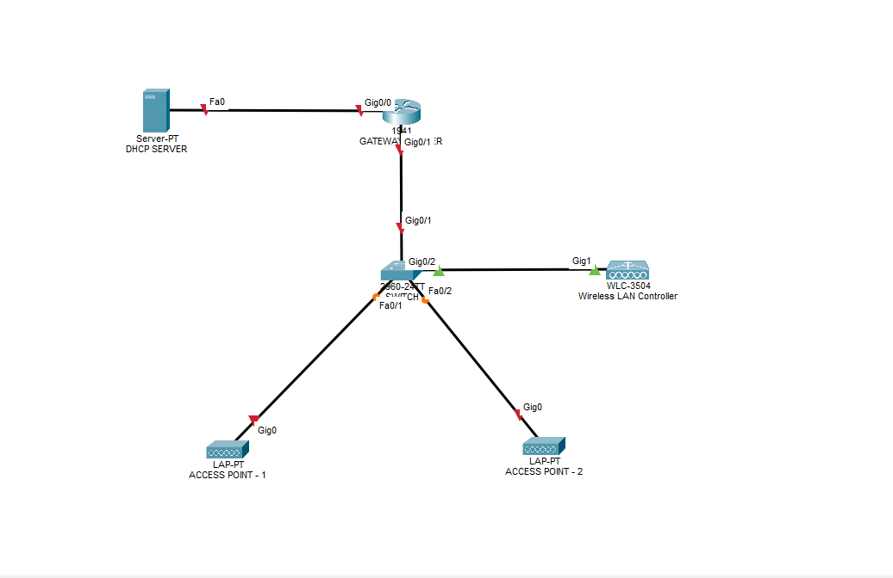

## VLAN Configuration and Verification

VLANs were created to segment the school network for staff, students, and network management.

- VLAN 10 – STAFF
- VLAN 20 – STUDENT
- VLAN 30 – MGT
- VLAN 999 – UNUSED

As part of basic switch port hardening, unused switch interfaces were assigned to VLAN 999 and administratively shut down to prevent unauthorized devices from connecting to inactive ports.

The VLAN configuration and port assignments were verified using `show vlan brief`.

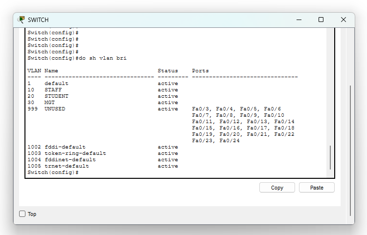

## 802.1Q Trunking

802.1Q trunking was configured between network infrastructure devices to allow multiple VLANs to traverse shared links.

VLAN 30 is configured as the native VLAN on the trunk links. The trunk links were also restricted to only the VLANs required for network operation: VLAN 10 (STAFF), VLAN 20 (STUDENT), and VLAN 30 (MGT).

verified using `show interfaces trunk`, confirming that the required interfaces are actively trunking and that the expected VLANs are allowed across each link.

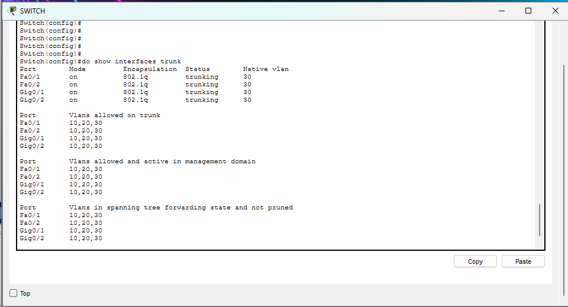

## Router-on-a-Stick and Inter-VLAN Routing

Router-on-a-stick was configured to provide Layer 3 connectivity between the segmented VLANs. The router uses 802.1Q subinterfaces, with each subinterface serving as the default gateway for its corresponding VLAN.

- **VLAN 10 – STAFF:** `192.168.10.1/24`
- **VLAN 20 – STUDENT:** `192.168.20.1/24`
- **VLAN 30 – MGT:** `192.168.30.1/24`

The subinterfaces were verified using `show ip interface brief`, confirming the interfaces are operational.

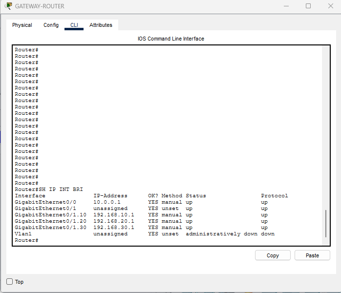

## DHCP Relay

A centralized DHCP server was configured with separate address pools for the STAFF, STUDENT, and MGT VLANs. Each pool provides clients with the appropriate default gateway, DNS server, and IP addressing information for its subnet.

Because the DHCP server resides on a different network from the client VLANs, DHCP relay was configured on the router using `ip helper-address` to forward DHCP requests to the centralized server.

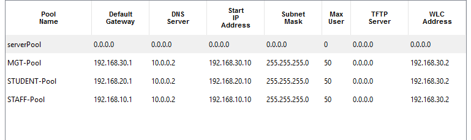

## Wireless LAN Controller (WLC)

A Wireless LAN Controller was configured to provide centralized management of the school's wireless infrastructure.

### Access Point Registration

Two lightweight access points were successfully registered with the Wireless LAN Controller and are centrally managed by the WLC.

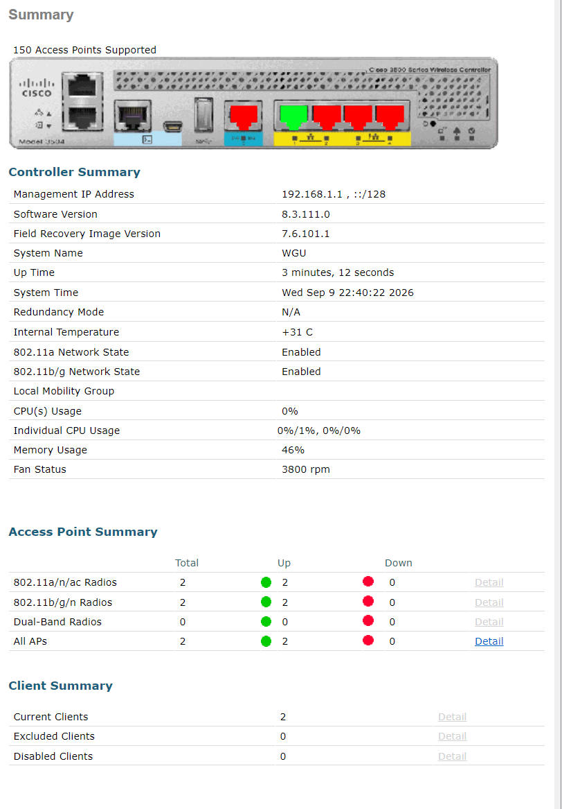

### WLC Management

The WLC uses VLAN 30 as the management network, allowing the controller and managed access points to communicate through the network infrastructure.

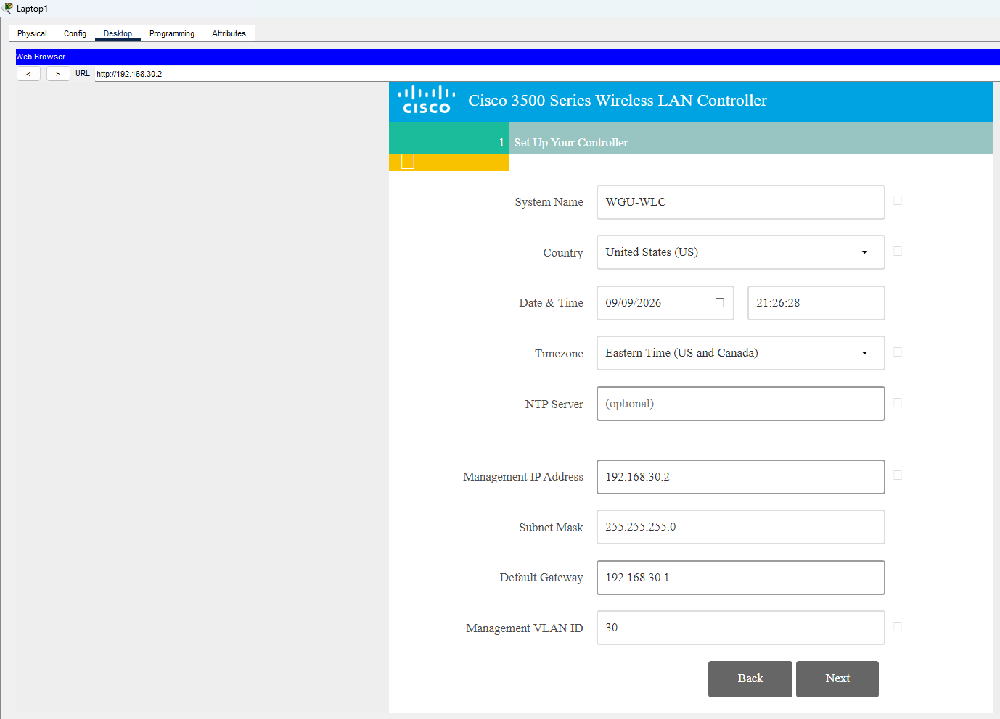

## WLC Dynamic Interfaces

Dynamic interfaces were configured on the Wireless LAN Controller to map wireless networks to their respective VLANs.

### Staff Wireless Network

The `STAFF-VLAN` dynamic interface was configured on the WLC and mapped to VLAN 10. The interface uses `192.168.10.2/24`, with `192.168.10.1` as the default gateway. The centralized DHCP server at `10.0.0.2` provides IP addressing for clients on this network.

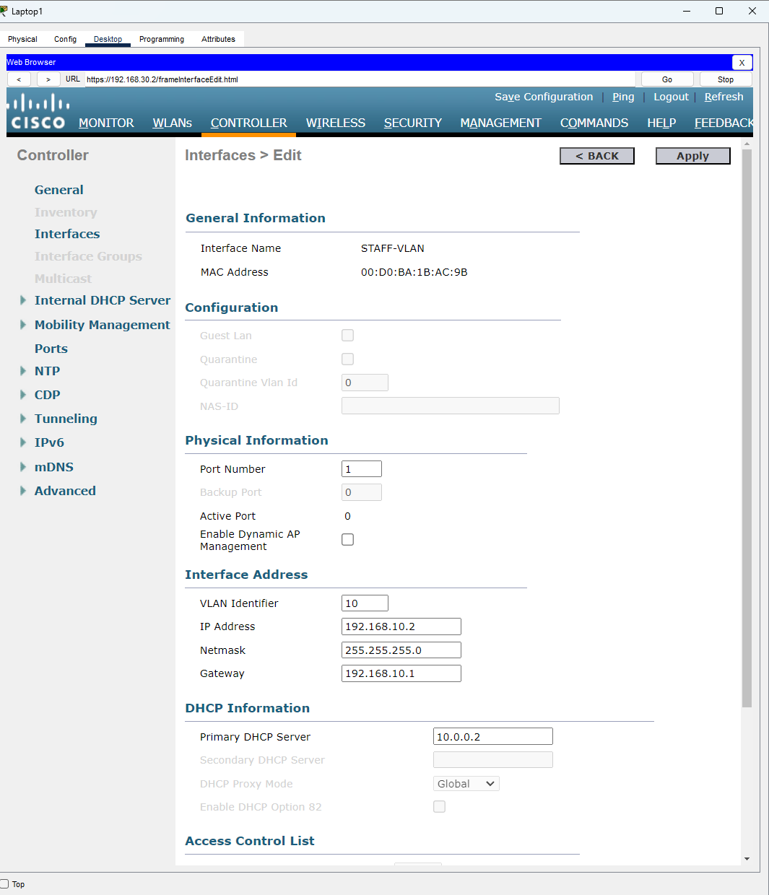

### Student Wireless Network

The `STUDENT-VLAN` dynamic interface was configured on the WLC and mapped to VLAN 20. The interface uses `192.168.20.2/24`, with `192.168.20.1` as the default gateway. The centralized DHCP server at `10.0.0.2` provides IP addressing for clients on this network.

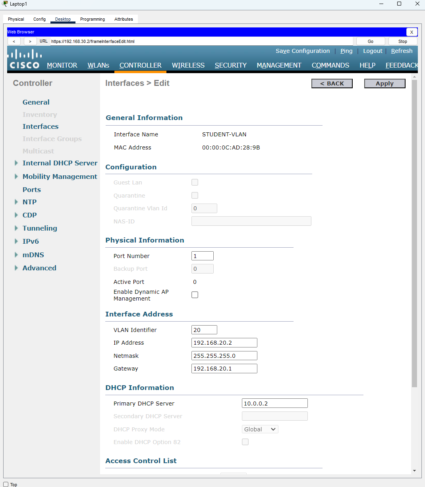

### Staff and Student WLAN

After configuring the dynamic interfaces, a dedicated WLAN was created for staff and student users with the SSID `STAFF-WIFI`, `STUDENT-WIFI`. The WLAN was mapped to their respective interface.

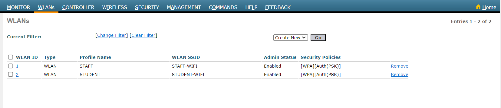

## Address Assignment

Wireless clients on both the STAFF and STUDENT networks successfully received IP addressing information through DHCP, confirming that the DHCP pools and relay configuration are functioning correctly.

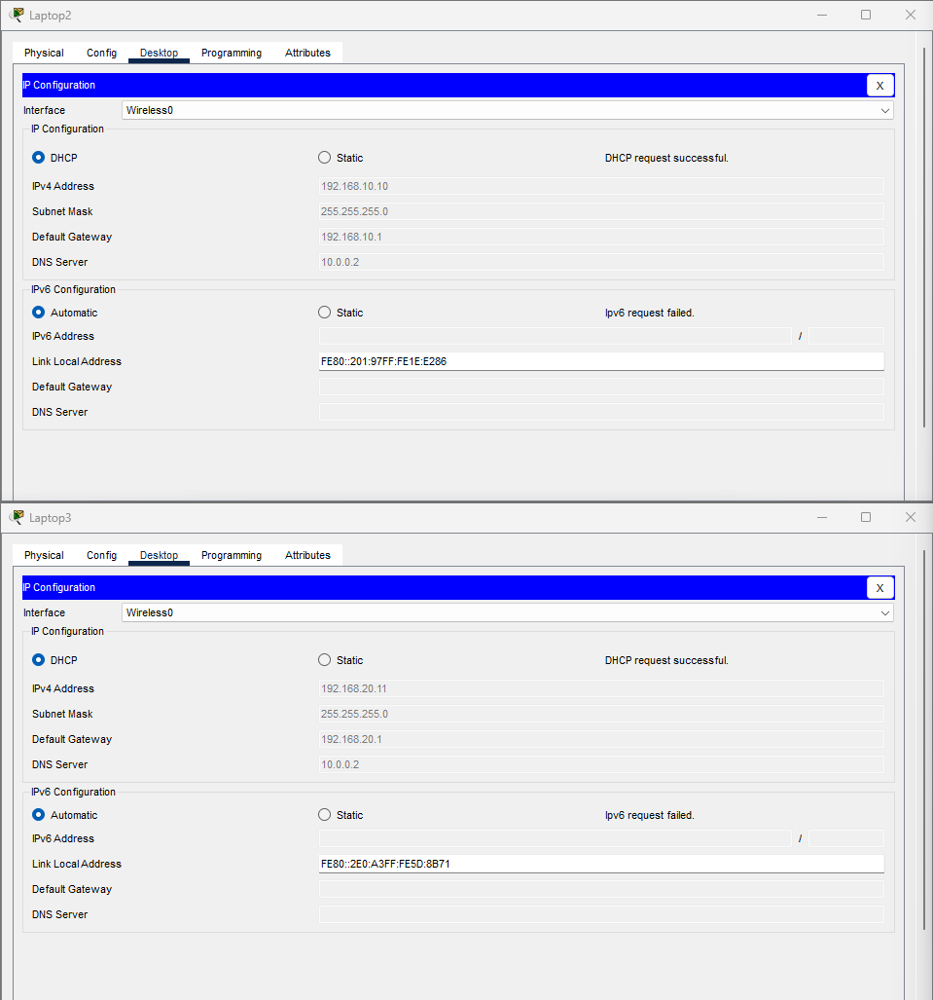

