# VTP & SVI Network Infrastructure Lab

## Network Topology

This project simulates a multi-floor network built in Cisco Packet Tracer, with three access switches connected to a Layer 3 distribution switch.

The primary focus of this project is demonstrating VLAN Trunking Protocol (VTP) for centralized VLAN distribution and Switch Virtual Interfaces (SVIs) for Layer 3 connectivity. SVIs are configured on the Layer 3 switch to provide default gateways and inter-VLAN routing for the Staff, Student, and Management VLANs. A management SVI is also configured on each access switch to provide remote management connectivity.

The project also incorporates 802.1Q trunking, DHCP relay, OSPF, SSH remote administration, and switch port hardening to demonstrate how these technologies work together in a segmented network.

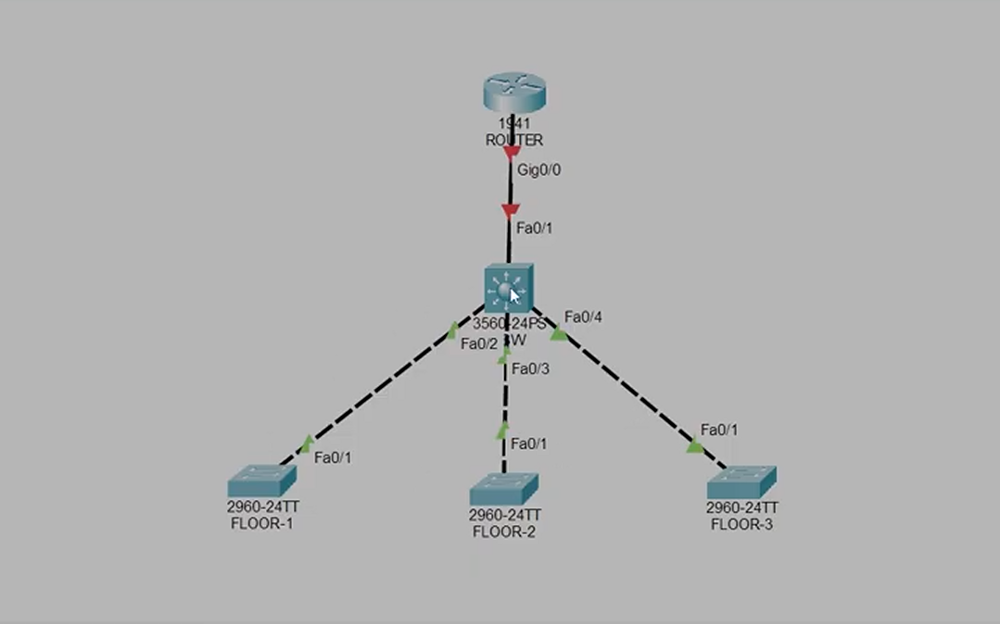

## Configuration Files

Each device configuration is provided as a `.txt` file and can be copied and pasted into the corresponding device in the **Starter topology** to recreate the completed network.

- [Router Configuration](configs/Router.txt)
- [Distribution Switch Configuration](configs/DSW.txt)
- [Floor 1 Switch Configuration](configs/FLOOR-1-SW.txt)
- [Floor 2 Switch Configuration](configs/FLOOR-2-SW.txt)
- [Floor 3 Switch Configuration](configs/FLOOR-3-SW.txt)

> **Note:** A fully configured Packet Tracer file is also included for reference.

## VTP Server and VLAN Configuration

The distribution switch is configured as the VTP Server for the WGU domain using VTP version 2. VLANs are created and maintained centrally on the VTP server, allowing VLAN information to be propagated to VTP client switches through trunk links.

The VLAN database separates the network into Staff (VLAN 10), Students (VLAN 20), Management (VLAN 30), Native (VLAN 99), and Unused (VLAN 999) networks.

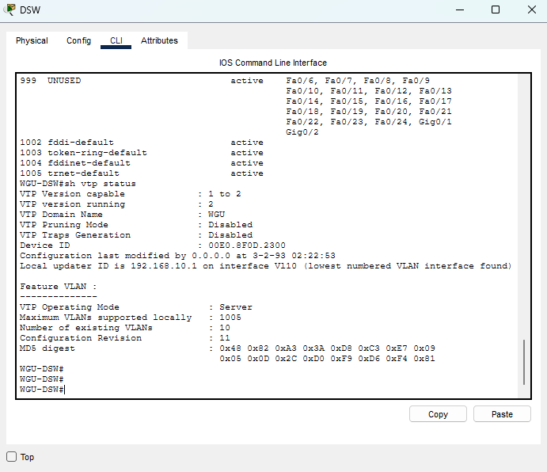
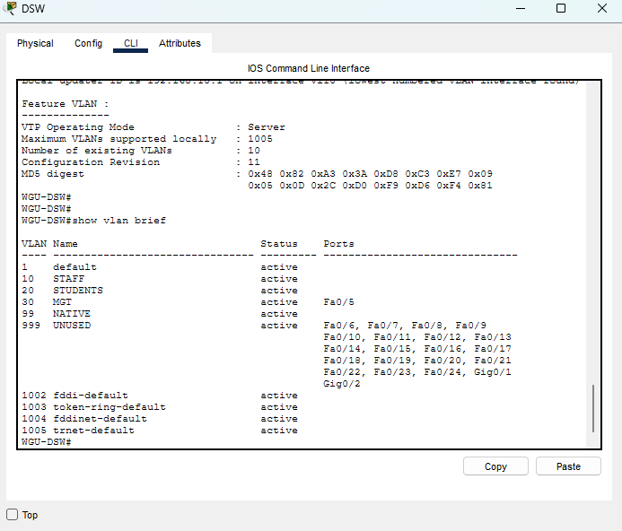

## VTP Client and VLAN Propagation

The Floor 1 access switch is configured as a VTP client within the WGU domain. VLAN information created on the distribution switch is automatically learned by the access switch through VTP rather than requiring each VLAN to be manually created on every switch.
The matching configuration revision number (11) and VLAN database verify that the VTP client successfully synchronized with the VTP server. VLANs 10, 20, 30, 99, and 999 are now available on the access switch.

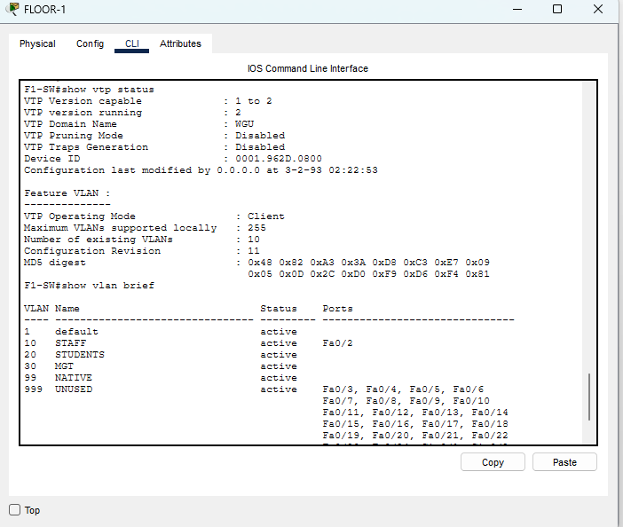

## 802.1Q Trunk Configuration

The uplink between the access switch and distribution switch is configured as an 802.1Q trunk, allowing multiple VLANs to traverse a single physical connection. The trunk is restricted to VLANs 10, 20, 30, and 99, ensuring that only VLANs required by the network are carried between switches. VLAN 99 is configured as the native VLAN.

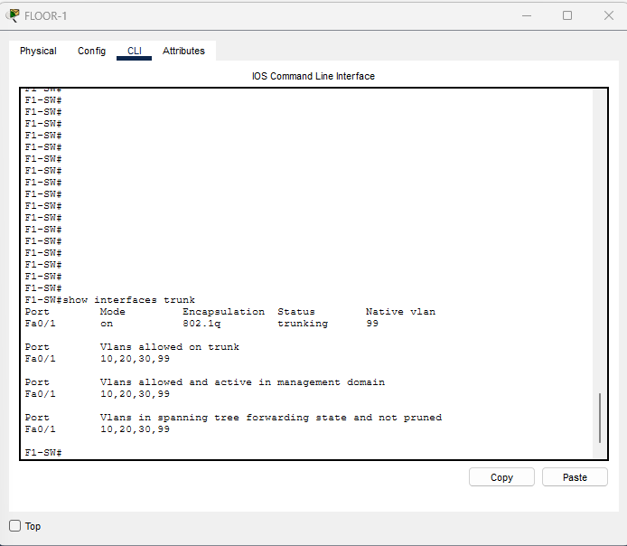

## SVI Configuration and Inter-VLAN Routing

Switch Virtual Interfaces (SVIs) are configured on the Layer 3 distribution switch to provide Layer 3 connectivity for each VLAN. The SVIs 192.168.10.1, 192.168.20.1, and 192.168.30.1 serve as the default gateways for the Staff, Student, and Management networks respectively, wIth IP routing enabled on the distribution switch.

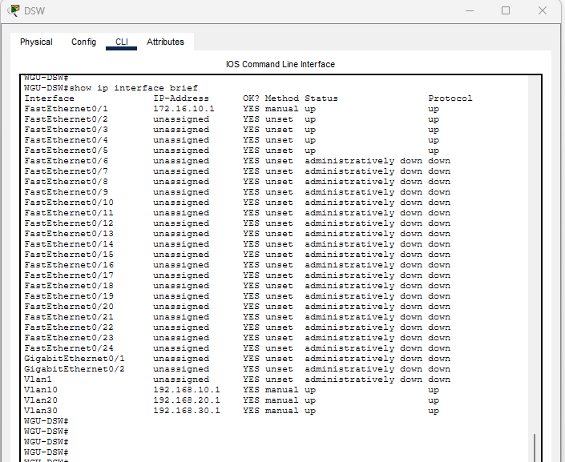

To verify inter-VLAN routing, connectivity was tested between hosts located in separate VLANs. The Student host (192.168.20.12/24) uses the VLAN 20 SVI (192.168.20.1) as its default gateway, while the Staff host (192.168.10.12/24) uses the VLAN 10 SVI (192.168.10.1).

The successful ping between the two different subnets confirms that the Layer 3 distribution switch is successfully routing traffic between VLANs through the configured SVIs.

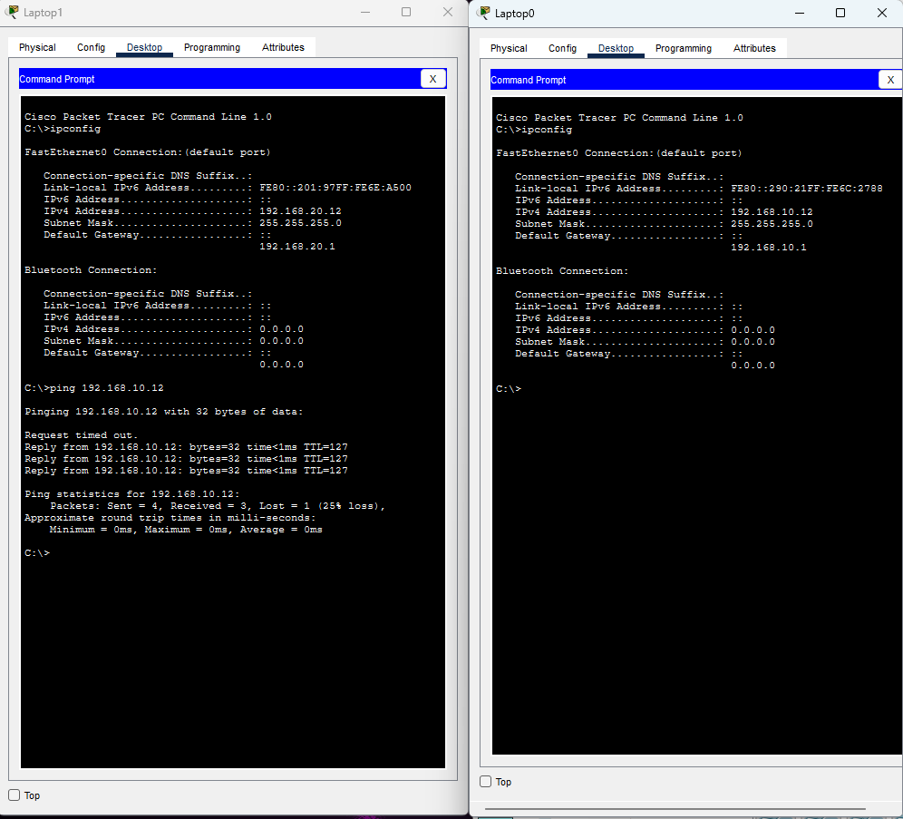

## Management SVI

The Floor 1, 2, 3 access switches uses an SVI on VLAN 30 with the IP address 192.168.30.2/24, 192.168.30.3/24, 192.168.30.4/24 respectively. Unlike the SVIs on the Layer 3 distribution switch, this SVI is not used for inter-VLAN routing. Instead, it provides the Layer 2 access switch with a management IP address, allowing the switch to be reached and administered remotely.

The access switch uses 192.168.30.1, the VLAN 30 SVI on the distribution switch, as their default gateway for management traffic destined for other networks.

SSH was used from a remote host to connect securely to the access switch using its management SVI. The successful login and remote execution of show ip interface brief verify that the switch is reachable and can be administered remotely through the management network.

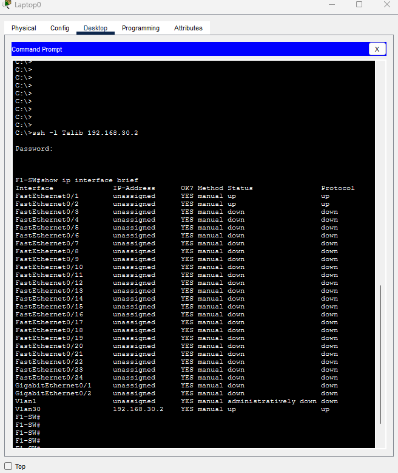

## DHCP Relay

The DHCP server is located on the router at 172.16.10.2, while client devices reside in separate VLANs. Because DHCP Discover messages are broadcasts and are not forwarded across Layer 3 boundaries, an ip helper-address is configured on each SVI.
The distribution switch relays DHCP requests from VLANs 10, 20, and 30 to the DHCP server at 172.16.10.2. This allows each VLAN to receive addressing from a centralized DHCP service while remaining in separate broadcast domains.

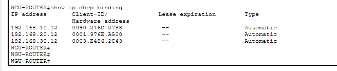

## OSPF Dynamic Routing

OSPF is configured between the distribution switch and router over the 172.16.10.0/30 network. 
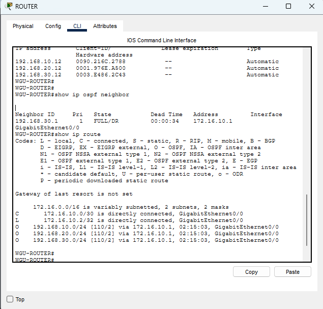

## Final Connectivity Verification

Final connectivity testing confirms successful communication between the edge router and the internal VLAN networks. The router successfully reaches the distribution switch at 172.16.10.1 and the Staff host at 192.168.10.12

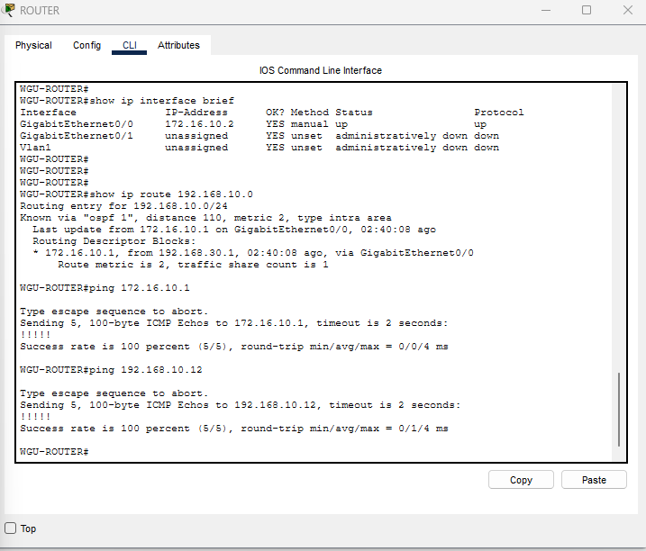

